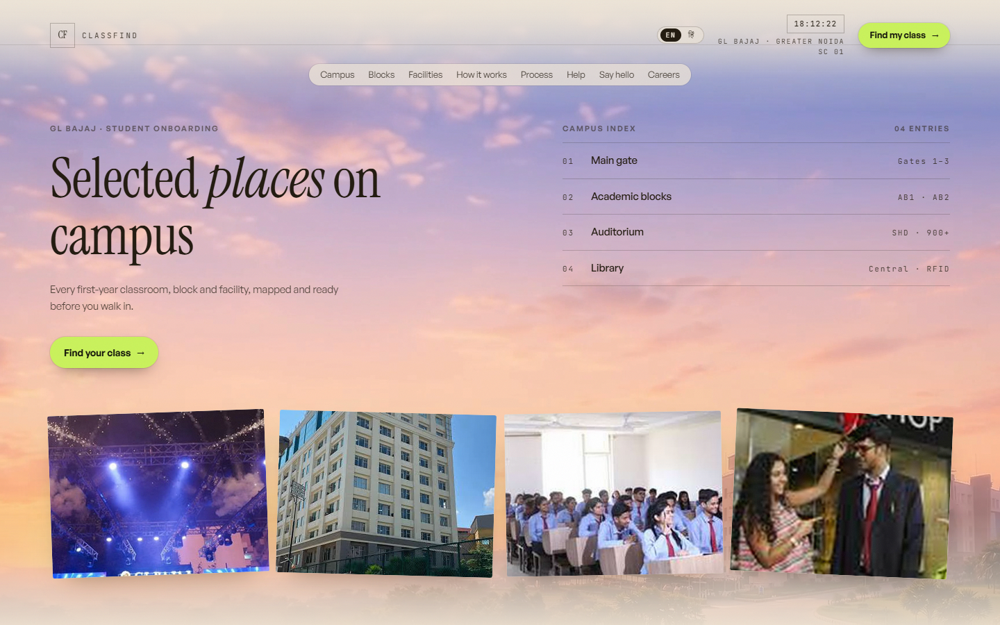
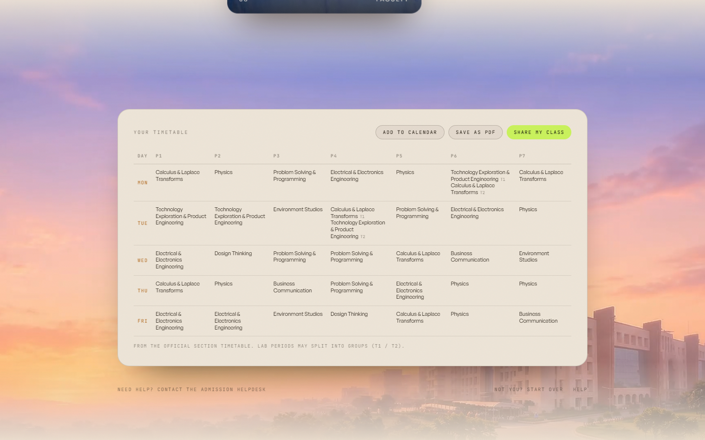

<div align="center">

# CLASSFIND

**Know your classroom before day one.**

Student onboarding for first-year engineering students. Verify who you are, and get your
section, roll number, classroom, subject teachers and weekly timetable — before you ever
walk onto campus.

[Live site](https://classfind.site) · [Admin](https://classfind.site/admin)

</div>


---

## The problem

On the first day of an Indian engineering college, a few thousand new students arrive at
once and have to answer the same three questions: *which section am I in, which room is
that, and who teaches me?* The answers exist, but they are spread across an Excel sheet,
a PDF on a notice board, and word of mouth.

CLASSFIND turns that into one lookup.

## What it does

- **Verify, don't guess.** A student enters the name and mobile number they submitted at
  admission. The match is exact against the uploaded student list — no fuzzy matching, and
  no way to see anyone else's record.
- **Know the classroom.** Section, roll number, room number, floor, building, and a
  schematic / 3D view of the block.
- **Know the teachers.** The class coordinator and the subject teachers for *that* section
  only. A teacher who covers ten sections appears on all ten, but each student sees only
  their own classroom's staff.
- **Know the week.** The official section timetable, with calendar export (`.ics`),
  print-to-PDF, and a shareable class card for the class group.
- **Join the class group.** The WhatsApp invite is delivered to the verified email — it is
  never exposed to the browser. Teachers can also project a QR generated from the same link.
- **Admin panel.** Students, sections, groups, faculty and assignments, timetable, and an
  audit log of every change.

## Screenshots

| Campus | Teachers |
| --- | --- |
|  |  |

| Timetable | Admin |
| --- | --- |
|  |  |


## Architecture

```
Browser
  │
  ├─ Next.js App Router (React 19, Server Components)
  │     │
  │     └─ OpenNext  ──►  Cloudflare Worker
  │                            │
  │                            └─ D1 (SQLite)
  │
  ├─ Client canvas  ──►  shareable class card (PNG)
  ├─ Client QR      ──►  group invite QR
  └─ three.js       ──►  3D campus tour
```

- **Next.js 15** (App Router) and **TypeScript**, deployed to **Cloudflare Workers** through
  **OpenNext**. Local development uses `node:sqlite`; production uses **D1**.
- **Tailwind CSS v4** with a small design-token layer (paper / carbon / amber) scoped per
  page section.
- **three.js** for the campus tour.
- No client state library. One small API surface, one database.

## Data model

The interesting design decision is faculty.

A naive schema stores one row per teacher per section, which duplicates the same person
across sections and makes a phone-number change a multi-row edit. Instead:

| Table | Holds |
| --- | --- |
| `faculty` | A **person** — name, phone, email, photo. Entered once. |
| `teaching` | An **assignment** — this person teaches this subject in this section. |
| `timetable_slots` | Section × day × period, with an optional group (T1/T2 lab splits). |

So "who teaches G1I?" is `teaching WHERE section = 'G1I'`, and a teacher covering ten
sections is ten assignment rows pointing at one person. The scoping rule lives in the
query, not in the UI.

Other tables: `students`, `sections`, `whatsapp_groups`, `invite_deliveries`, `otps`,
`audit_log`, and `students_backup` (a snapshot taken before every import).

## Privacy by design

This repository ships **no real student data**.

- `data/seed/students.generated.json` contains **24 synthetic students** with obviously
  fake mobile numbers.
- The real seed, the SQLite database, and `.env.local` are gitignored.
- The WhatsApp invite link is never returned to the browser — it is delivered to the
  verified email address after OTP confirmation.
- OTPs are stored hashed and expire; verification is rate-limited.

If you fork this to run it for a real cohort, keep those properties.

## Tech stack

`Next.js 15` · `React 19` · `TypeScript` · `Tailwind CSS v4` · `three.js` · `D1 / SQLite`
· `Cloudflare Workers` · `OpenNext` · `xlsx` (student import) · `qrcode` · `PyMuPDF`
(timetable parsing)

## Running locally

```bash
npm install
cp .env.example .env.local     # set ADMIN_PASSWORD and AUTH_SECRET
npm run dev
```

Open 

### Environment

| Variable | Purpose |
| --- | --- |
| `ADMIN_PASSWORD` | Admin panel password |
| `AUTH_SECRET` | Signs the admin session cookie |
| `RESEND_API_KEY` / `BREVO_API_KEY` | Email delivery for invites (optional; simulated if absent) |
| `FAST2SMS_API_KEY` / `MSG91_AUTH_KEY` / `TWILIO_*` | OTP delivery (optional; simulated if absent) |

Without provider keys the flows still run end-to-end and print a simulated OTP or email
preview, so the app is testable with no third-party accounts.

## Deployment

```bash
npx opennextjs-cloudflare build
npx wrangler deploy
```

`wrangler.jsonc` defines a production database and a separate `dev` environment, so the
two never share data.

## Timetable ingestion

The official timetable is a PDF, not a spreadsheet. Its meaning lives in the *coordinates*
of the text, so a plain text dump comes out scrambled.

`scripts/parse_timetable.py` uses PyMuPDF to read word bounding boxes, rebuild the
day/period grid, map subject codes to names, and detect **two-period lab cells** that are
merged across columns. It writes `data/seed/timetable.generated.json`, which the app seeds
on first run.

```bash
python scripts/parse_timetable.py path/to/time_table.pdf
```

## Project structure

```
app/            routes, API handlers
components/     UI (film scroll, campus reel, faculty deck, admin)
lib/            db, auth, importer, timetable export, share card
scripts/        seed + timetable parsers (Python)
data/seed/      synthetic student seed + generated timetable
docs/           screenshots
public/         fonts, images, campus 

## License

MIT — see [LICENSE](LICENSE).

<div align="center">

Built by [Gursimran Singh](https://github.com/gursimran217)

</div>
